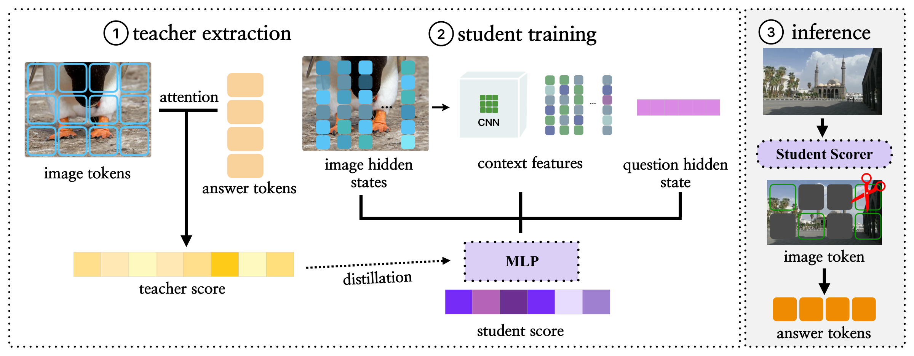

<div align="center">

# Q-ViK: Question-Guided Visual KV Cache Eviction for Large Vision-Language Models

**Solhee Hwang, Jangho Kim\*** · Kookmin University (\*corresponding author)

**NeurIPS 2026**

[-b31b1b)](#)
[](https://neurips.cc/Conferences/2026)
[](https://huggingface.co/ssoree912/Q-ViK)
[](LICENSE)

</div>

---

Official PyTorch implementation of **Q-ViK**, a question-conditioned visual KV cache eviction method for large vision-language models (LLaVA-OneVision, LLaVA-1.5). Offline, full-cache decoding gives an answer-to-visual attention signal that marks the visual KV entries future answer tokens actually reuse, and a lightweight question-conditioned scorer is trained to predict it from prefill representations alone. At inference, a single post-prefill scoring step evicts low-utility visual KV entries while keeping every text KV entry, with no full-cache lookahead or generated traces. See the paper for details.

<p align="center">
  
</p>

## Environment

```bash
conda env create -f environment.yml
conda activate qvik
```

## Models

| Model | HuggingFace | Local path |
|---|---|---|
| LLaVA-OneVision-Qwen2-7B | [lmms-lab/llava-onevision-qwen2-7b-ov](https://huggingface.co/lmms-lab/llava-onevision-qwen2-7b-ov) | `model/llava-onevision-qwen2-7b-ov` |
| LLaVA-1.5-7B | [liuhaotian/llava-v1.5-7b](https://huggingface.co/liuhaotian/llava-v1.5-7b) | `model/llava-v1.5-7b` |

### Pretrained Q-ViK checkpoints

| Student | HuggingFace | Local path |
|---|---|---|
| LLaVA-OneVision-Qwen2-7B | [ssoree912/Q-ViK](https://huggingface.co/ssoree912/Q-ViK/tree/main/qvik_student_onevision) | `ckpts/qvik_student_onevision` |
| LLaVA-1.5-7B | [ssoree912/Q-ViK](https://huggingface.co/ssoree912/Q-ViK/tree/main/qvik_student_llava15) | `ckpts/qvik_student_llava15` |

```bash
huggingface-cli download ssoree912/Q-ViK --local-dir ckpts --include "qvik_student_*"
```

With these checkpoints you can skip teacher extraction and student training and go straight to [evaluation](#3-evaluation).

## Datasets

### Training (teacher extraction)

- [TextVQA](https://textvqa.org/)
- [GQA](https://cs.stanford.edu/people/dorarad/gqa/)
- [ScienceQA](https://scienceqa.github.io/)

### Evaluation

- [TextVQA](https://textvqa.org/)
- [GQA](https://cs.stanford.edu/people/dorarad/gqa/)
- [ChartQA](https://github.com/vis-nlp/ChartQA)
- [DocVQA](https://www.docvqa.org/)
- [COCO Caption](https://cocodataset.org/)
- [NoCaps](https://nocaps.org/)
- [TextCaps](https://textvqa.org/textcaps/)

## Data Structure

```
data/
├── train/
│   ├── textvqa/          # TextVQA train images & annotations
│   ├── gqa/              # GQA train images & questions
│   ├── scienceqa/        # ScienceQA images & problems.json
│   └── teacher/
│       ├── llava15/      # extracted teacher scores for LLaVA-1.5
│       └── llava_onevision/  # extracted teacher scores for OneVision
└── eval/
    ├── textvqa_val/                  # TextVQA val (or TextVQA/data/*.parquet)
    ├── GQA/                          # testdev_balanced_{instructions,images}
    ├── ChartQA/data/
    ├── DocVQA/DocVQA/
    ├── COCO-Caption2017/data/
    ├── NoCaps/data/
    └── TextCaps/data/
```

## Pipeline

### 1. Teacher extraction


```bash
# OneVision
for ds in textvqa gqa scienceqa; do
  python qvik/teacher/extract_llava_onevision.py \
    --model model/llava-onevision-qwen2-7b-ov \
    --dataset $ds --n-samples 600 \
    --output-root data/train/teacher/llava_onevision
done

# LLaVA-1.5
for ds in textvqa gqa scienceqa; do
  python qvik/teacher/extract_llava15.py \
    --model model/llava-v1.5-7b \
    --dataset $ds --n-samples 600 \
    --output-root data/train/teacher/llava15
done
```


### 2. Student training


```bash
# OneVision
python qvik/train/llava_onevision.py \
  --teacher-root data/train/teacher/llava_onevision \
  --llava-path model/llava-onevision-qwen2-7b-ov \
  --epochs 20 \
  --output-dir ckpts/qvik_student_onevision

# LLaVA-1.5
python qvik/train/llava15.py \
  --teacher-root data/train/teacher/llava15 \
  --llava-path model/llava-v1.5-7b \
  --epochs 15 \
  --output-dir ckpts/qvik_student_llava15
```

### 3. Evaluation


Results are written to `results/<model_tag>/keep<keep_ratio>/<task>/`
(`model_tag` is `llava15_lmms` or `onevision_lmms`). Available tasks: `textvqa`,
`chartqa`, `docvqa`, `gqa`, `coco_cap`, `nocaps`, `textcaps`.

`keep_ratio` is the fraction of image tokens kept (text KVs are never evicted)
for both backbones. LLaVA-1.5 also accepts `keep_ratio_basis=total`, where the
budget is `keep_ratio` x all prompt tokens (still evicting image tokens only).

The first answer token comes from the full (uncompressed) prefill and eviction
applies from the second token on (`prefill_mode=origin`, the default). Pass
`prefill_mode=qvik` in `--model_args` for delayed replay, where the last prompt
token is replayed through the compressed cache so the first answer token is
also produced under eviction.

**lmms-eval (LLaVA-1.5)** 
```bash
python qvik/eval/run_lmms_eval.py \
  --model lmms_llava15_student \
  --model_args pretrained=model/llava-v1.5-7b,student_path=ckpts/qvik_student_llava15,keep_ratio=0.5,device=cuda:0 \
  --tasks textvqa,chartqa,docvqa,gqa,coco_cap,nocaps,textcaps \
  --batch_size 1 \
  --output_path results
```

**lmms-eval (OneVision)** 
```bash
python qvik/eval/run_lmms_eval.py \
  --model lmms_onevision_student \
  --model_args pretrained=model/llava-onevision-qwen2-7b-ov,student_path=ckpts/qvik_student_onevision,keep_ratio=0.5,device=cuda:0 \
  --tasks textvqa,chartqa,docvqa,gqa,coco_cap,nocaps,textcaps \
  --batch_size 1 \
  --output_path results
```


## License

This project is released under the [Apache License 2.0](LICENSE).

It includes code adapted from the following projects, each distributed under the Apache License 2.0 (see the `LICENSE` file in each directory):

- [LLaVA](https://github.com/haotian-liu/LLaVA) — `qvik/llava15/`
- [LLaVA-NeXT](https://github.com/LLaVA-VL/LLaVA-NeXT) — `qvik/llava_onevision/`
